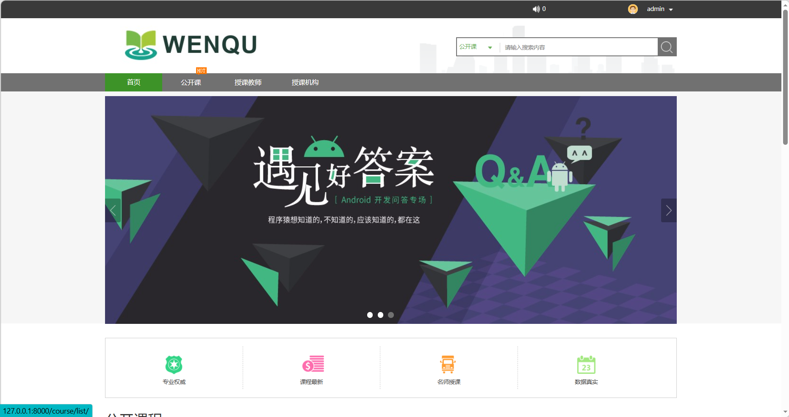
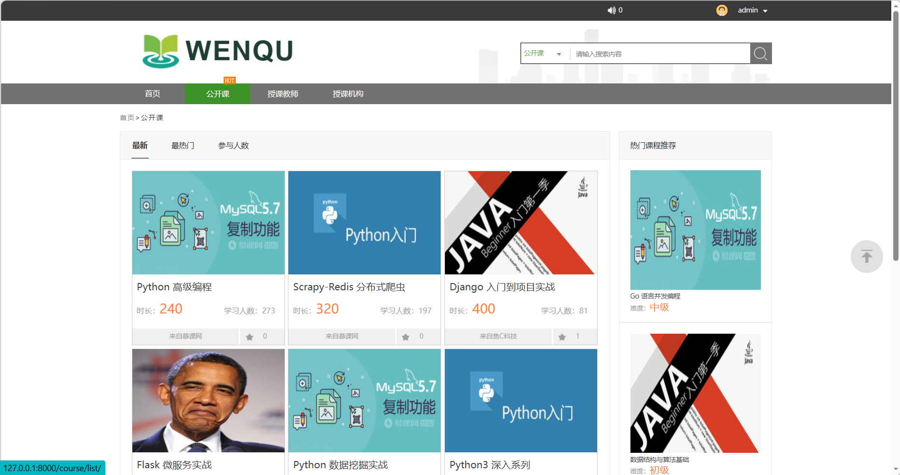
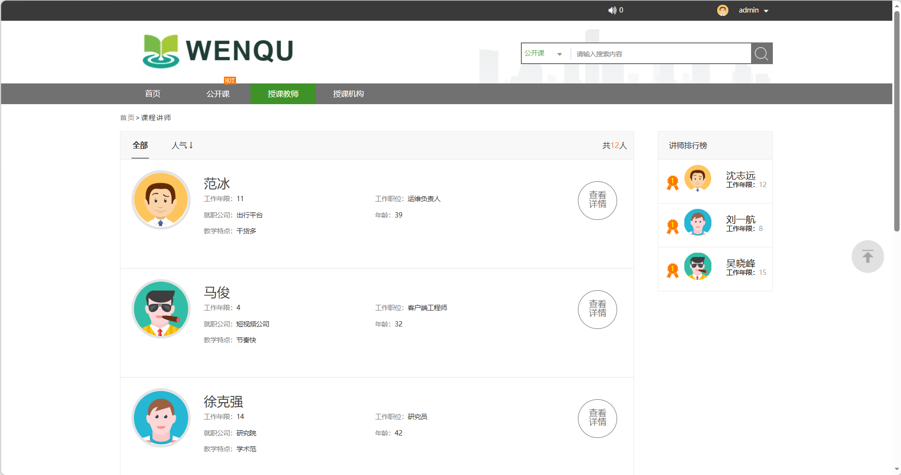
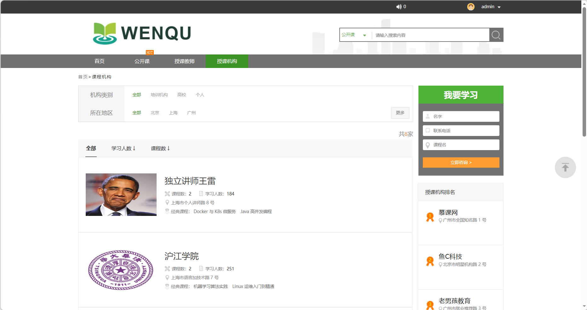
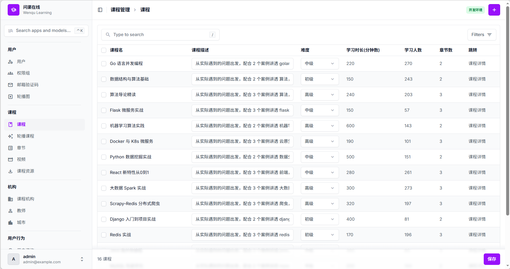

# 问渠在线 · Wenqu

「问渠那得清如许，为有源头活水来」—— 一个基于 Django 6.1 + django-unfold 的在线教育平台演示项目，包含公开课程、课程机构、授课教师、学员中心四个板块，以及一套 unfold 主题的后台。

## 界面预览

首页轮播与四大板块入口：



公开课列表，支持最新 / 最热门 / 参与人数排序，右侧为热门课程推荐：



授课教师列表与讲师排行榜：



授课机构列表，支持按机构类别与所在地区筛选：



后台采用 django-unfold 主题，侧栏按用户 / 课程 / 机构 / 用户行为分组：



## 技术栈

| 组件                            | 版本          | 用途                                     |
| ------------------------------- | ------------- | ---------------------------------------- |
| Python                          | 3.12.13       | 运行时（`.python-version` 已固定）       |
| Django                          | 6.1.2         | Web 框架                                 |
| django-unfold                   | 0.109.0       | 后台主题（替代原 xadmin）                |
| django-ckeditor-5               | 0.2.20        | 课程详情 / 机构介绍的富文本编辑          |
| django-simple-captcha           | 0.7.0         | 注册、找回密码的图形验证码               |
| Pillow                          | 12.3.0        | 头像、封面图等图片处理                   |
| dj-database-url + python-dotenv | 3.1.2 / 1.2.4 | 用 `.env` 里的 `DATABASE_URL` 切换数据库 |
| WhiteNoise                      | 6.12.0        | 生产环境自带静态文件服务                 |
| psycopg 3                       | 3.3.6         | PostgreSQL 驱动（生产用）                |
| uv                              | —             | 依赖与虚拟环境管理                       |

## 快速开始

```bash
uv sync                        # 建 .venv 并装依赖
uv run manage.py migrate       # 建表（默认开发库 db.sqlite3）

# 可选：灌一批演示数据（3 城市 / 8 机构 / 12 讲师 / 18 课程 / 4 用户 / 收藏评论消息）
DJANGO_SETTINGS_MODULE=settings.dev uv run python seed_demo.py

uv run manage.py runserver     # http://127.0.0.1:8000
```

`seed_demo.py` 有防重入：库里已有机构或用户就直接退出，不会覆盖你的数据。

演示账号（仅由 `seed_demo.py` 创建）：

| 账号        | 密码            | 说明                                                                    |
| ----------- | --------------- | ----------------------------------------------------------------------- |
| `admin`     | `admin123456`   | 超级用户，登录 http://127.0.0.1:8000/admin/                             |
| `student`   | `student123456` | 有学习记录、收藏、评论与消息，适合看个人中心                            |
| `teacher01` | `teacher123456` | 讲师账号                                                                |
| `newbie`    | `newbie123456`  | 未激活，激活码 `DEMO-ACTIVATE-CODE`，访问 `/active/DEMO-ACTIVATE-CODE/` |

## 配置

`settings/` 拆成四份，`manage.py` 默认使用 `dev`：

- `base.py` —— 公共配置、`INSTALLED_APPS`、UNFOLD 侧栏、CKEditor 5 工具栏
- `dev.py` —— `DEBUG=True`，没配 SMTP 凭据时邮件打印到控制台
- `prod.py` —— `DEBUG=False`，启动前强制校验 `DJANGO_SECRET_KEY`、`DJANGO_ALLOWED_HOSTS` 与 PostgreSQL 引擎，缺一项就 `ImproperlyConfigured`
- `test.py` —— 内存 SQLite + locmem 邮件 + `CAPTCHA_TEST_MODE=True` + MD5 哈希（快）

环境变量见 `.env.example`（复制成 `.env` 生效）。开发用可以全部留空；数据库留空即 SQLite，填 `DATABASE_URL=postgres://...` 则切到 PostgreSQL。

## 测试

```bash
uv run manage.py test --settings=settings.test
```

132 项，覆盖自定义认证后端、注册与验证码、找回密码的会话绑定、个人中心、课程/机构/讲师列表与筛选、收藏计数的原子更新、列表取数的固定排序、后台各模型页面与筛选器、后台列表的查询数不随行数增长、分页标签、邮件正文与收件人。不依赖外部服务。

## 目录结构

```
根目录              项目配置：settings/ 四份、urls.py、admin.py（unfold AdminSite + 环境角标）、wsgi/asgi/manage
apps/
  users/               用户、验证码记录、首页轮播、自定义认证后端、登录注册与找回密码视图
  courses/             课程、章节、视频、下载资源
  organization/        城市、课程机构、讲师、咨询与收藏接口
  operation/           用户消息、收藏、评论、学习记录、咨询
  utils/               分页封装与模板标签、邮件发送、收藏状态查询、测试夹具
templates/             前台页面与 includes/pagination.html
static/  media/        静态资源 / 用户上传文件
seed_demo.py           演示数据生成脚本
```

## 生产部署

先在 `.env` 里填好 `DJANGO_SECRET_KEY`、`DJANGO_ALLOWED_HOSTS` 和指向 PostgreSQL 的 `DATABASE_URL`，否则 `prod` 配置会直接抛 `ImproperlyConfigured`。

```bash
uv run manage.py collectstatic --settings=settings.prod
uv sync --group deploy                                   # 装 gunicorn
DJANGO_SETTINGS_MODULE=settings.prod uv run gunicorn wsgi:application --bind 0.0.0.0:8000
```

静态文件由 WhiteNoise 的 `CompressedStaticFilesStorage` 提供；`prod` 配置默认开启 HTTPS 跳转与 HSTS，放在 Nginx 之后时按需设 `USE_X_FORWARDED_HOST`、`SECURE_SSL_REDIRECT`。
